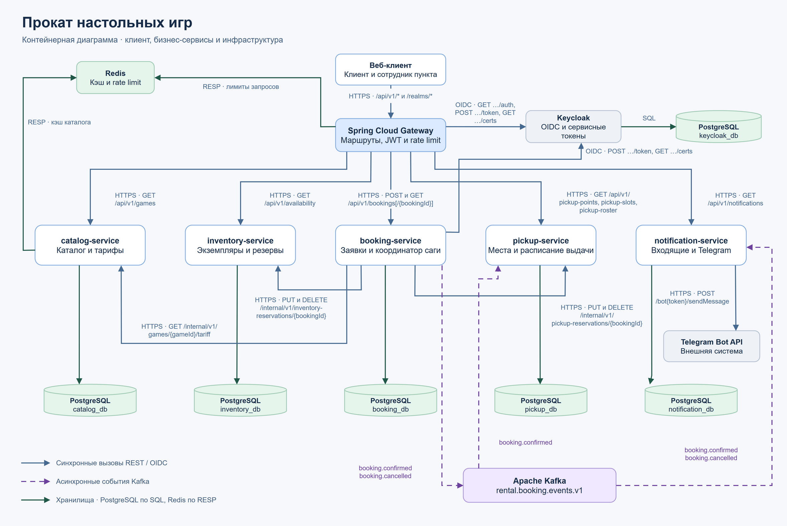
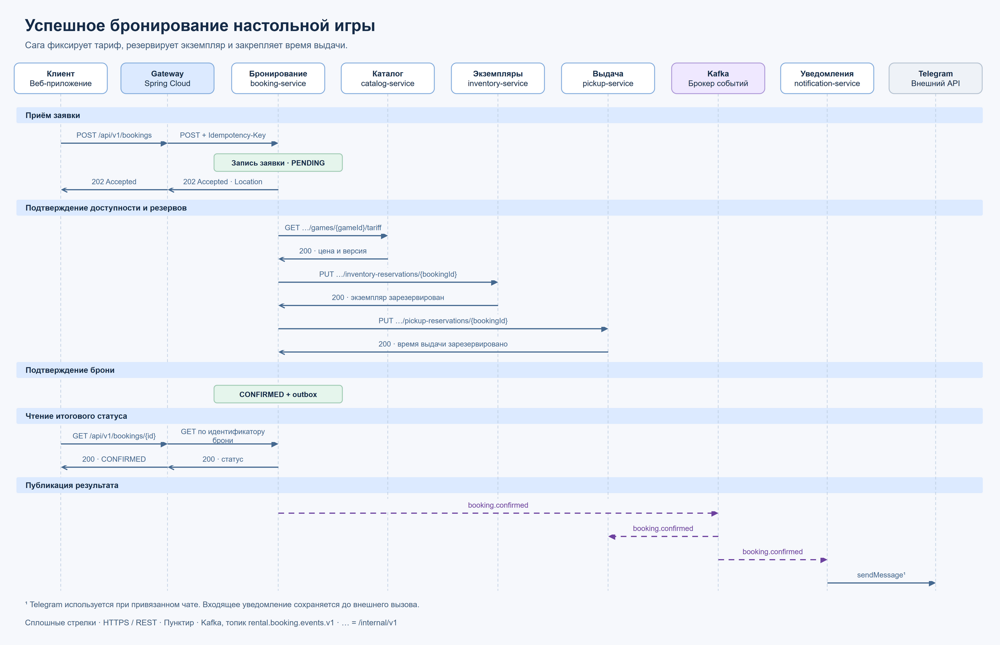
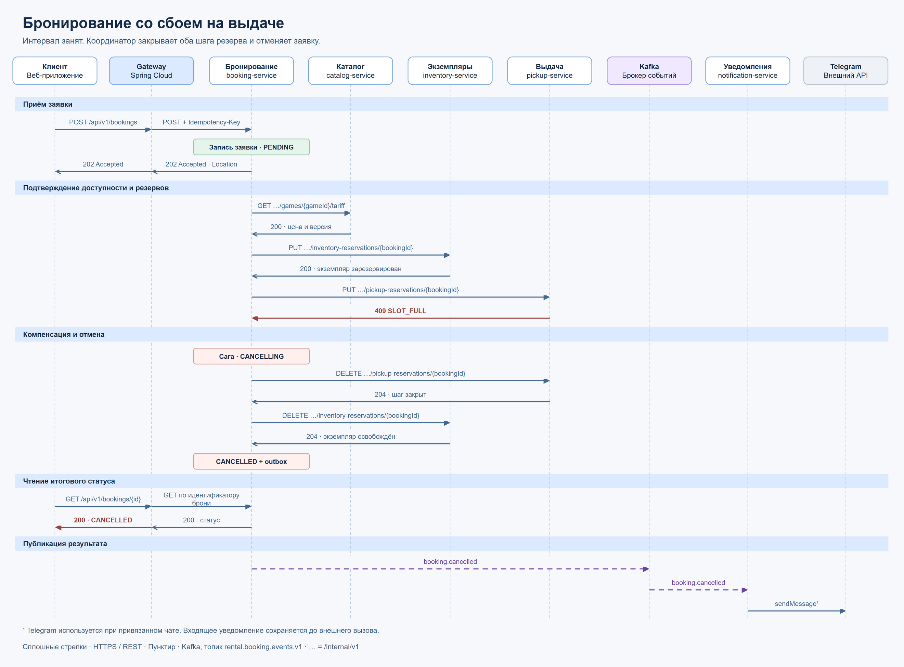

# Лабораторная работа № 3. Декомпозиция и проектирование микросервисной системы

## Прокат настольных игр

Веб-сервис помогает клиентам выбрать настольную игру и забронировать её на несколько дней в одном из пунктов проката. При оформлении система фиксирует тариф, закрепляет свободный экземпляр и бронирует время выдачи. Клиент видит результат бронирования в личном кабинете и может получить сообщение в Telegram. Сотрудник пункта смотрит список подтверждённых выдач на выбранный день. Выдачу, оплату и возврат оформляют на месте.

### Акторы

| Актор | Что делает |
| --- | --- |
| Клиент | Выбирает игру, пункт и период проката, бронирует время выдачи, отслеживает статус |
| Сотрудник пункта проката | Просматривает список подтверждённых выдач своего пункта |
| Keycloak | Выполняет вход пользователя и выдаёт токены с ролью и идентификатором пользователя |
| Telegram Bot API | Принимает сообщения для клиентов с привязанным чатом |

### Пользовательские сценарии

1. Как клиент, я хочу просматривать каталог игр, чтобы выбрать игру и узнать суточный тариф.
2. Как клиент, я хочу проверять доступность игры на нужные даты в конкретном пункте, чтобы спланировать прокат.
3. Как клиент, я хочу видеть адреса пунктов и интервалы выдачи, чтобы выбрать место и время посещения.
4. Как клиент, я хочу оформить бронь и узнать её итоговый статус, чтобы понимать, можно ли идти за игрой.
5. Как клиент, я хочу видеть уведомления о результате бронирования, чтобы быстро найти информацию о выдаче.
6. Как сотрудник пункта, я хочу видеть подтверждённые выдачи на выбранный день, чтобы подготовить игры к приходу клиентов.

## Доменные события и ограниченные контексты

События ниже описывают уже произошедшие изменения. Два события бронирования передаются через Kafka. Остальные фиксируются в транзакциях своих сервисов как изменения доменного состояния.

| Контекст | Сущности | Доменные события |
| --- | --- | --- |
| Каталог | Игра, тариф | ИграДобавлена, ТарифИзменён |
| Экземпляры | Экземпляр, резерв экземпляра | ЭкземплярЗарезервирован, РезервЭкземпляраСнят |
| Бронирование | Бронирование, снимок тарифа, шаг саги | БроньСоздана, БроньПодтверждена, БроньОтменена |
| Выдача | Пункт выдачи, интервал выдачи, запись на выдачу | ВремяВыдачиЗарезервировано, РезервВремениСнят, ВыдачаВключенаВРасписание |
| Уведомления | Уведомление, привязка чата, попытка доставки | УведомлениеСоздано, СообщениеОтправлено |

### Глоссарий

| Контекст | Термины |
| --- | --- |
| Каталог | **Игра** — карточка настольной игры. **Суточный тариф** — цена одного дня проката в копейках. **Версия тарифа** — номер редакции опубликованной цены. |
| Экземпляры | **Экземпляр** — конкретная пронумерованная коробка в пункте. **Доступность** — наличие экземпляра без пересекающихся резервов. **Резерв экземпляра** — закрепление коробки за бронью на период проката. |
| Бронирование | **Бронирование** — заявка клиента на прокат. **Снимок тарифа** — версия и цена, зафиксированные при оформлении. **Компенсация** — снятие резервов при отмене заявки. |
| Выдача | **Пункт** — место, где клиент получает игру. **Интервал выдачи** — отрезок времени с ограниченным числом записей. **Запись на выдачу** — место, закреплённое за бронью в выбранном интервале. |
| Уведомления | **Уведомление** — запись о результате бронирования во входящих сообщениях клиента. **Привязка чата** — соответствие аккаунта подтверждённому Telegram-чату. **Попытка доставки** — зафиксированный результат вызова Telegram Bot API. |

## Карточки бизнес-сервисов

Целевые нагрузки и задержки используются при проектировании. Задержки относятся к p95 для штатного режима, если в карточке указан HTTP-запрос.

| Сервис | Ответственность и данные | API и события | Зависимости | Нагрузка и критичность | Обоснование границы |
| --- | --- | --- | --- | --- | --- |
| `catalog-service` | Публикует карточки и тарифы. Владеет играми, тарифами и их версиями. | Список игр, действующий тариф для расчёта брони | PostgreSQL `catalog_db`, Redis | До 60 запросов/с, чтение до 150 мс. Тариф обязателен для оформления. | Каталог читают чаще остальных сервисов. Карточки и цены меняются независимо от движения экземпляров. |
| `inventory-service` | Определяет доступность и выделяет конкретный экземпляр. Владеет экземплярами и их резервами. | Проверка доступности, установка и снятие резерва | PostgreSQL `inventory_db` | До 25 запросов/с, резерв до 250 мс. Корректность резерва критична. | Защита от двойного бронирования требует транзакции над собственными экземплярами. |
| `booking-service` | Хранит заявки и координирует оформление. Владеет бронями, снимками тарифов, состоянием саги, ключами повторов и outbox. | Приём заявки и чтение статуса. Публикует `booking.confirmed` и `booking.cancelled`. | Синхронно вызывает каталог, учёт экземпляров и выдачу. Использует PostgreSQL `booking_db` и Kafka. | До 10 новых броней/с, приём заявки до 300 мс. Подтверждение в штатном режиме до 5 с. | Заявка и её жизненный цикл образуют одну бизнес-возможность. Координатор хранит прогресс и может продолжить работу после перезапуска. |
| `pickup-service` | Управляет вместимостью интервалов выдачи и списком для сотрудников. Владеет пунктами, интервалами, записями и inbox. | Списки пунктов, интервалов и подтверждённых выдач, установка и снятие резерва. Получает `booking.confirmed`. | PostgreSQL `pickup_db`, Kafka | До 25 запросов/с, резерв до 200 мс. Появление в списке до 5 с после подтверждения в штатном режиме. | Вместимость зависит от расписания пункта. Изменения графика и задержки списка выдач изолированы от каталога и учёта экземпляров. |
| `notification-service` | Записывает уведомления и при наличии привязки отправляет их в Telegram. Владеет уведомлениями, привязками чатов, попытками доставки и inbox. | Список уведомлений. Получает `booking.confirmed` и `booking.cancelled`. | PostgreSQL `notification_db`, Kafka, Telegram Bot API | До 20 событий/с. Запись уведомления до 5 с и первая попытка Telegram до 30 с в штатном режиме. | Доставка зависит от внешнего провайдера и ограничений его API. Задержка сообщения не должна задерживать бронь. |

Рассматривалось объединение каталога с учётом экземпляров. Каталог обслуживает много чтений, для которых подходит кэш, а учёт экземпляров выполняет конкурентные записи, где требуется транзакционная проверка дат. Раздельные контексты позволяют менять тариф независимо от правил распределения коробок и масштабировать чтение каталога отдельно.

## Стек и инфраструктура

| Компонент | Кто использует | Обоснование |
| --- | --- | --- |
| Java 17, Spring Boot 3.4, Maven | Пять бизнес-сервисов | Spring Web подходит для REST-контрактов, Spring Data для локальных транзакций, Spring Kafka для публикации и обработки событий. Maven даёт единый процесс сборки. |
| PostgreSQL | Пять бизнес-сервисов и Keycloak | У каждого своя БД и отдельная роль. В учёте экземпляров ограничение пересечения диапазонов защищает от двух резервов одного экземпляра. В выдаче транзакция под блокировкой строки интервала проверяет вместимость. У бронирования статус и outbox записываются одной транзакцией. Для Keycloak предусмотрена отдельная `keycloak_db`. |
| Redis | Каталог и Spring Cloud Gateway | Каталог кэширует страницы списка на 60 секунд, а актуальный тариф для брони читает из PostgreSQL. Шлюз хранит счётчики частоты запросов. При недоступности Redis каталог читает БД, а шлюз применяет локальный ограничитель до восстановления. |
| Apache Kafka | Бронирование, выдача, уведомления | У выдачи и уведомлений независимые группы потребителей. После восстановления они продолжают чтение со своих смещений. Ключ `bookingId` задаёт порядок событий одной брони внутри раздела. |
| Spring Cloud Gateway | Веб-клиент | Принимает HTTPS-запросы, проверяет токены, ограничивает частоту и маршрутизирует открытые API. Публичные OIDC-маршруты передаёт Keycloak. |
| Keycloak | Шлюз и бизнес-сервисы | OIDC Authorization Code с PKCE для веб-клиента. Сервисы проверяют подпись и аудиторию JWT. Работник саги получает сервисный JWT через client credentials со сферой `booking:orchestrate`. |
| Telegram Bot API | Уведомления | Доставляет сообщения клиентам, для которых в сервисе есть предварительно подтверждённая привязка чата. |
| Docker Compose | Учебное окружение | Позволяет запустить сервисы и инфраструктуру в приватной сети с публикацией порта шлюза. |

`/api/v1/*` доступен через Gateway. Клиентский JWT использует `sub` для доступа к собственным броням и уведомлениям. Список выдач требует роль `pickup-staff` и доступ к указанному пункту. `/internal/v1/*` доступен в сервисной сети для JWT работника саги. Вход в систему проходит через маршрут Keycloak на том же шлюзе.

## Архитектура и взаимодействия

[Исходник архитектурной схемы в draw.io](docs/architecture.drawio)



| Инициатор → получатель | Тип | Контракт | Назначение |
| --- | --- | --- | --- |
| Веб-клиент → Gateway → Keycloak | sync | `GET /realms/board-rental/protocol/openid-connect/auth`, `POST /realms/board-rental/protocol/openid-connect/token` | Вход и обмен кода на токен |
| Gateway и сервисы → Keycloak | sync | `GET /realms/board-rental/protocol/openid-connect/certs`, `POST /realms/board-rental/protocol/openid-connect/token` для работника саги | Ключи проверки JWT и токен работника саги |
| Gateway → Каталог | sync | `GET /api/v1/games` | Список игр |
| Gateway → Учёт экземпляров | sync | `GET /api/v1/availability` | Доступность игры на период |
| Gateway → Бронирование | sync | `POST /api/v1/bookings`, `GET /api/v1/bookings/{bookingId}` | Приём заявки и чтение статуса |
| Gateway → Выдача | sync | `GET /api/v1/pickup-points`, `GET /api/v1/pickup-slots`, `GET /api/v1/pickup-roster` | Адреса пунктов, интервалы и список подтверждённых выдач |
| Gateway → Уведомления | sync | `GET /api/v1/notifications` | Входящие уведомления |
| Бронирование → Каталог | sync | `GET /internal/v1/games/{gameId}/tariff` | Снять текущую версию тарифа |
| Бронирование → Учёт экземпляров | sync | `PUT /internal/v1/inventory-reservations/{bookingId}`, `DELETE /internal/v1/inventory-reservations/{bookingId}` | Установить или снять резерв экземпляра |
| Бронирование → Выдача | sync | `PUT /internal/v1/pickup-reservations/{bookingId}`, `DELETE /internal/v1/pickup-reservations/{bookingId}` | Установить или снять резерв времени |
| Бронирование → Kafka → Выдача | async | `rental.booking.events.v1` · `booking.confirmed` | Добавить подтверждённую выдачу в список сотрудников |
| Бронирование → Kafka → Уведомления | async | `rental.booking.events.v1` · `booking.confirmed`, `booking.cancelled` | Создать уведомление по результату |
| Уведомления → Telegram Bot API | sync | `POST /bot{token}/sendMessage` | Отправить сообщение в привязанный чат |

### Сага оформления брони

Работник `booking-service` координирует сагу. Зафиксированная заявка и ключ запроса сохраняются одной транзакцией, клиент получает `202 Accepted` со статусом `PENDING` и URL опроса. Повтор того же POST с тем же ключом и телом возвращает тот же идентификатор. Изменение тела с тем же ключом возвращает `409`. Ключ привязан к `sub` и хранится не менее 24 часов с момента завершения саги.

Период проката задаётся датами в часовом поясе Москвы как `[startsOn, endsOn)` длительностью от 1 до 7 дней. Интервал выдачи должен относиться к дате `startsOn` и указанному клиентом пункту. При резервировании до начала интервала должно оставаться не меньше двух минут. Цена равна числу календарных дней, умноженному на суточный тариф. Список свободных игр и интервалов даёт предварительную оценку, а успешные локальные транзакции резервов подтверждают доступность.

#### Успешное оформление

Работник фиксирует снимок тарифа, резервирует экземпляр и время выдачи. Затем сохраняет `CONFIRMED` и `booking.confirmed` в локальной транзакции. Место в интервале учитывается с момента резерва, а сотрудник видит его после обработки события подтверждения. Клиент получает итоговый статус при следующем запросе.

[Исходник успешного сценария в draw.io](docs/sequence-success.drawio)



#### Сбой при резервировании времени выдачи

Если интервал занят, `pickup-service` отвечает `409 SLOT_FULL`. Координатор переводит бронь в `CANCELLING`, фиксирует снятие резерва выдачи и освобождает экземпляр. Запрос на снятие резерва выдачи записывает признак отмены даже при отсутствии резерва. После обоих `204` координатор сохраняет `CANCELLED` и `booking.cancelled`. Пункт выдачи не получает подтверждение. Клиент видит причину отмены в статусе и уведомлении.

[Исходник сценария сбоя в draw.io](docs/sequence-failure.drawio)



| Сбой | Поведение системы |
| --- | --- |
| Запись заявки прервана до ответа `202` | Клиент повторяет POST с исходным ключом. Сервер возвращает сохранённую бронь либо создаёт её, если транзакция не завершилась. |
| Игра или тариф отсутствуют | Бронь отменяется с причиной `GAME_UNAVAILABLE`. Резервов к этому моменту нет. |
| Экземпляр занят | Координатор закрывает начатый шаг инвентаря операцией DELETE, затем отменяет бронь с `GAME_UNAVAILABLE`. |
| Интервал не найден, занят, недоступен по времени или относится к другому пункту или дате | Компенсация идёт в обратном порядке. Шаг выдачи закрывается через DELETE, затем освобождается экземпляр. |
| Таймаут, `503` или перезапуск работника | Прогресс хранится в БД. Работник повторяет запрос с тем же ключом шага. Таймаут внутреннего запроса 800 мс, задержки между повторами 1, 2, 4 секунды и далее до 15 секунд. По истечении 2 минут с создания заявки координатор переходит к компенсации всех начатых шагов с причиной `DEPENDENCY_TIMEOUT`. |
| Ошибка при компенсации | Бронь остаётся в `CANCELLING`. Работник повторяет незавершённые DELETE с ограниченной задержкой и сигнализирует оператору после 5 минут. В `CANCELLED` бронь переходит после закрытия всех начатых шагов. |
| Kafka временно недоступна | Outbox остаётся в БД. Публикация возобновляется после восстановления Kafka. До доставки события возможна задержка списка выдач и уведомления. |
| Потребитель Kafka не обработал сообщение | Событие обрабатывается повторно. После исчерпания повторов потребитель записывает его в DLT своей группы, откуда оператор возвращает его в обработку после устранения ошибки. |
| Telegram временно недоступен | При обработке события уведомление и задача отправки сохраняются локально. Отдельный работник повторяет отправку с учётом `Retry-After` при ответе `429`. После исчерпания попыток статус доставки становится `FAILED`. После неясного ответа провайдера возможен повтор сообщения в Telegram. |

Координатор фиксирует начало шага до сетевого вызова и допускает одного активного работника на бронь с проверкой версии состояния при записи. Для каждого PUT и DELETE используется отдельный стабильный ключ, связанный с идентификатором брони и действием. В обоих сервисах резервов DELETE идемпотентен и под блокировкой записывает признак отмены по `bookingId`. Поздний PUT с тем же `bookingId` получает `409 RESERVATION_CLOSED`, даже если он пришёл после потерянного ответа. Признак хранится вместе с историей резерва. Такая проверка защищает от восстановления удалённого резерва после завершения компенсации.

## События Kafka

| Топик | Событие | Издатель | Подписчики | Схема |
| --- | --- | --- | --- | --- |
| `rental.booking.events.v1` | `booking.confirmed` | `booking-service` | `pickup-service` и `notification-service` | [BookingConfirmed](api/booking-events.asyncapi.yaml#L62) |
| `rental.booking.events.v1` | `booking.cancelled` | `booking-service` | `notification-service` | [BookingCancelled](api/booking-events.asyncapi.yaml#L197) |

Ключ Kafka и `correlationId` равны `bookingId`. Конверт содержит `eventId`, `eventType`, `occurredAt`, `schemaVersion` и `payload`. Публикация через outbox и доставка Kafka выполняются как минимум один раз. Потребитель записывает `eventId` в inbox вместе с бизнес-изменением и подтверждает смещение после фиксации транзакции. У выдачи группа `pickup-service` принимает оба типа из топика и пропускает отмену после проверки типа. Группа `notification-service` обрабатывает оба типа. Топики ошибок `rental.booking.events.v1.pickup.dlt` и `rental.booking.events.v1.notification.dlt` предназначены для технического восстановления. В DLT сохраняются исходное сообщение и ключ, а в заголовках передаются причина ошибки и координаты исходной записи.

## Контракты API

| Сервис | Спецификация |
| --- | --- |
| Каталог | [catalog-service.yaml](api/catalog-service.yaml) |
| Учёт экземпляров | [inventory-service.yaml](api/inventory-service.yaml) |
| Бронирование | [booking-service.yaml](api/booking-service.yaml) |
| Выдача | [pickup-service.yaml](api/pickup-service.yaml) |
| Уведомления | [notification-service.yaml](api/notification-service.yaml) |
| Kafka | [booking-events.asyncapi.yaml](api/booking-events.asyncapi.yaml) |

## Интерактивная документация

Все контракты собраны в один просмотрщик [docs/swagger-ui/index.html](docs/swagger-ui/index.html): REST-сервисы показаны в Swagger UI, события Kafka — в AsyncAPI UI, переключение между спецификациями через список в шапке.

Страница работает без интернета и сервера — достаточно открыть её двойным щелчком, бандлы Swagger UI 5.36.0 и AsyncAPI React Component 3.2.3 лежат в том же каталоге. Публичная копия опубликована через GitHub Pages: [bedoevsky.github.io/board-game-rental-lab3/docs/swagger-ui](https://bedoevsky.github.io/board-game-rental-lab3/docs/swagger-ui/).

Просмотрщик читает спецификации из `docs/swagger-ui/specs.js`, а не из `api/*.yaml`: YAML-якоря и алиасы (`&a1`, `*a2`) нужно предварительно развернуть, а при открытии файла напрямую браузер не сможет загрузить схему по HTTP. После правки `api/*.yaml` пересоберите бандл:

```bash
npm install
npm run build:docs
```
